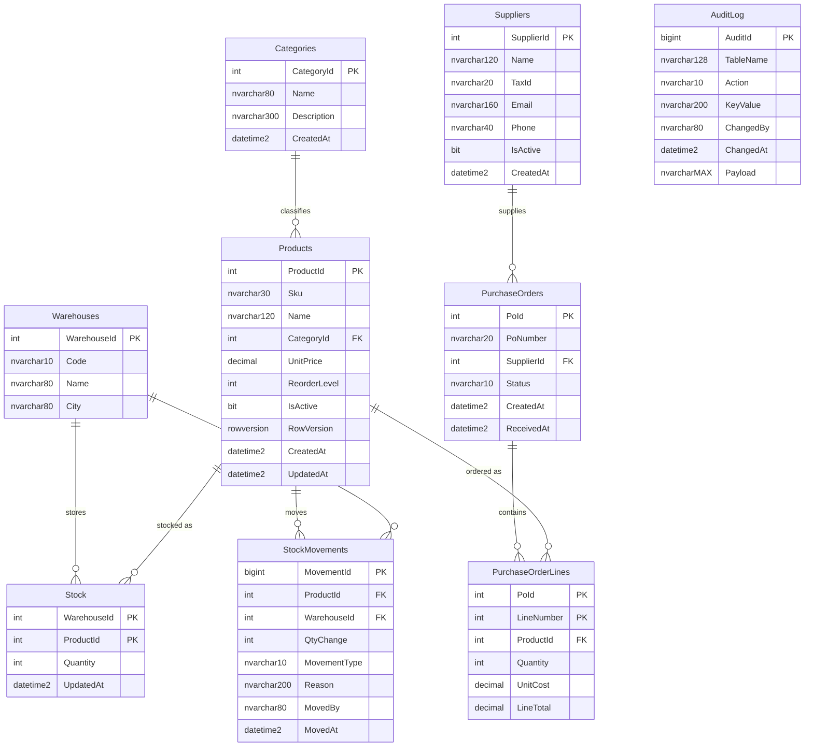

# sql-server-inventory-demo

[](https://github.com/MrLooy/sql-server-inventory-demo/actions/workflows/ci.yml)

A SQL Server portfolio project: a normalized **inventory** database written in
T-SQL, showcasing schema design, indexes, views, functions, stored procedures,
triggers and analytical queries — all with **fictional** sample data.

The goal is to demonstrate practical SQL Server / T-SQL skills (the kind asked
for in junior .NET developer roles) in a small, realistic domain.

> **Status:** the database layer (scripts `01`–`08`), the .NET 8 API and the
> xUnit test suite are complete. Verified on SQL Server LocalDB (SQL Server 2025)
> locally; the SQL Server 2022 **Docker container is validated by CI** —
> [see the CI status](https://github.com/MrLooy/sql-server-inventory-demo/actions/workflows/ci.yml).

## Tech

- SQL Server: tested on SQL Server 2025 (LocalDB); intended for 2019+
- Pure T-SQL: DDL, indexes, views, functions, stored procedures, triggers
- Optional: Docker for a one-command local server

## Schema

Ten tables, normalized to 3NF:

`Categories`, `Suppliers`, `Warehouses`, `Products`, `Stock`,
`StockMovements`, `PurchaseOrders`, `PurchaseOrderLines`, `AuditLog`
plus the sequence `seq_PoNumber`.



A rendered version of the diagram is also kept in [`docs/ERD.md`](docs/ERD.md).

## Repository structure

```
db/
  01_schema.sql          Database + tables, constraints, sequence (DDL)
  02_indexes.sql         Nonclustered, covering and filtered indexes
  03_views.sql           Reporting views
  04_functions.sql       Scalar UDF + inline table-valued function
  05_procedures.sql      Stored procedures (transactions, TRY/CATCH, MERGE)
  06_triggers.sql        AFTER trigger writing to AuditLog
  07_seed.sql            Fictional sample data (idempotent)
  08_demo_queries.sql    Analytical queries (CTE, window functions, PIVOT, JSON)
src/Inventory.Api/       .NET 8 minimal API calling the stored procedures (ADO.NET)
tests/Inventory.Tests/   xUnit integration tests (run the scripts, then assert)
.github/workflows/ci.yml CI: SQL Server 2022 container + dotnet test
docs/ERD.md              Entity-relationship diagram (mermaid)
docker-compose.yml       SQL Server 2022 container
.env.example             Template for local secrets
```

## Requirements

- Tested on SQL Server 2025 (LocalDB); intended for 2019+, with `sqlcmd` — **or** Docker
- Windows LocalDB works too (`SqlLocalDB`) with no extra install
- .NET 8 SDK (or newer) to build and run the API

## Quick start — provided server (Docker)

```bash
cp .env.example .env          # then set a strong MSSQL_SA_PASSWORD
docker compose up -d          # starts mcr.microsoft.com/mssql/server:2022-latest
```

Load the database (run in order; scripts are idempotent and re-runnable):

```bash
docker exec -i inventorydemo-sqlserver \
  /opt/mssql-tools18/bin/sqlcmd -S localhost -U sa -P "$MSSQL_SA_PASSWORD" -C -b \
  -i /dev/stdin < db/01_schema.sql
# repeat 02..08 in order
```

## Quick start — LocalDB (Windows, no Docker)

```powershell
# Start the instance once
SqlLocalDB start MSSQLLocalDB

# Run every script in order (01..08)
Get-ChildItem db\*.sql | Sort-Object Name | ForEach-Object {
  sqlcmd -S "(localdb)\MSSQLLocalDB" -E -b -i $_.FullName
}
```

Each script prints a `NN_... OK` line on success. They are safe to re-run:
`01_schema.sql` recreates the objects and `07_seed.sql` reseeds the data.

Quick checks:

```sql
SELECT COUNT(*) AS Products FROM dbo.Products;          -- 8
SELECT * FROM dbo.vw_LowStock;                          -- products at/below reorder level
EXEC dbo.usp_LowStockReport;                            -- ranked low-stock report
EXEC dbo.usp_GetProductMovementJson
     @From = '2020-01-01', @To = '2999-01-01';          -- JSON of all movements
```

## API (.NET 8 minimal API)

A small ASP.NET Core **minimal API** exposes the stored procedures through
ADO.NET (`Microsoft.Data.SqlClient`) — parameters are passed explicitly with
`CommandType.StoredProcedure`, no ORM. It reads the connection string from
`ConnectionStrings:Inventory` (see `src/Inventory.Api/appsettings.json`).
Override it with the `ConnectionStrings__Inventory` environment variable (or
`CONNECTION_STRING`) to point at Docker.

```bash
dotnet run --project src/Inventory.Api --urls http://localhost:5080
```

### Endpoints

| Method | Route | Backing object |
| --- | --- | --- |
| GET  | `/health` | connectivity check |
| GET  | `/products` | `dbo.Products` |
| GET  | `/stock/{warehouseId}` | `dbo.vw_StockOnHand` |
| GET  | `/reports/low-stock?categoryId=` | `dbo.usp_LowStockReport` |
| GET  | `/reports/movements?from=&to=` | `dbo.usp_GetProductMovementJson` |
| POST | `/purchase-orders/{id}/receive?movedBy=` | `dbo.usp_ReceivePurchaseOrder` |
| POST | `/stock/adjust` | `dbo.usp_AdjustStock` |

Business errors raised with `THROW` in the procedures are returned as
`400 application/problem+json`.

> **Demo only:** there is no authentication, and `movedBy` is a plain query
> parameter — it is stored as-is and must not be trusted in a real system.

### Examples (real responses, verified against LocalDB)

`GET /reports/low-stock`
```json
[{"productId":5,"sku":"SKU-2003","productName":"27-inch Monitor","categoryName":"Peripherals","reorderLevel":6,"totalQuantity":3,"stockMargin":-3,"severityRank":1}]
```

`GET /stock/2` (first row)
```json
{"warehouseId":2,"warehouseCode":"WH-ARE","warehouseName":"Arequipa Warehouse","productId":1,"sku":"SKU-1001","productName":"Laptop Pro 14","categoryName":"Computers","quantity":6,"reorderLevel":5,"unitPrice":3500.00,"stockValue":21000.00,"updatedAt":"2026-10-12T07:30:42.448"}
```

`POST /purchase-orders/2/receive?movedBy=admin`
```json
{"poId":2,"poNumber":"PO-1001","status":"RECEIVED","linesTotal":2}
```

`POST /stock/adjust` with body
`{"productId":1,"warehouseId":1,"qtyChange":7,"reason":"Manual adjust","movedBy":"admin"}`
```json
{"productId":1,"warehouseId":1,"newQuantity":24,"movementType":"ADJUST"}
```

`POST /stock/adjust` with `qtyChange = -9999` → `400`
```json
{"type":"https://tools.ietf.org/html/rfc9110#section-15.5.1","title":"Database validation error","status":400,"detail":"Adjustment would result in negative stock.","sqlErrorNumber":50013}
```

curl equivalents:

```bash
curl http://localhost:5080/reports/low-stock
curl http://localhost:5080/stock/2
curl -X POST "http://localhost:5080/purchase-orders/2/receive?movedBy=admin"
curl -X POST http://localhost:5080/stock/adjust -H "Content-Type: application/json" \
     -d '{"productId":1,"warehouseId":1,"qtyChange":7,"reason":"Manual adjust","movedBy":"admin"}'
```

## T-SQL techniques demonstrated

| Technique | Where |
| --- | --- |
| Normalized schema, `PK`/`FK`, `CHECK`, `UNIQUE`, `DEFAULT` | `db/01_schema.sql` |
| Composite primary key | `dbo.Stock`, `dbo.PurchaseOrderLines` |
| `SEQUENCE` + default from sequence (`NEXT VALUE FOR`) | `dbo.seq_PoNumber` |
| `ROWVERSION` optimistic-concurrency token | `dbo.Products` |
| Persisted computed column | `dbo.PurchaseOrderLines.LineTotal` |
| Nonclustered, covering (`INCLUDE`) and filtered indexes | `db/02_indexes.sql` |
| Views | `db/03_views.sql` |
| Scalar UDF + inline table-valued function | `db/04_functions.sql` |
| Stored procedures: transactions, `TRY/CATCH`, `THROW`, `OUTPUT` parameters | `db/05_procedures.sql` |
| `MERGE` (upsert) with documented pitfalls | `dbo.usp_UpsertSupplier` |
| `AFTER` trigger writing JSON audit rows | `db/06_triggers.sql` |
| CTE, window functions (`ROW_NUMBER`, `RANK`, running total) | `db/08_demo_queries.sql` |
| `PIVOT` | `db/08_demo_queries.sql` |
| `STRING_AGG`, `FOR JSON PATH`, `OPENJSON` | `db/08_demo_queries.sql` |
| Conditional aggregation (`SUM(CASE ...)`) + `HAVING` | `db/08_demo_queries.sql` |
| `TRY_CONVERT`, `EOMONTH`, `DATEADD` | `db/08_demo_queries.sql` |

## Sample queries & expected output

**PIVOT — stock per warehouse (`08`, Q4):**

```
ProductSku  WH-LIM  WH-ARE  TotalUnits
----------  ------  ------  ----------
SKU-1001    12      6       18
SKU-2003    3       0       3
SKU-3003    2       9       11
```

**Running total with a window function (`08`, Q2):**

```
Sku       MovedAt     QtyChange  RunningBalance  MovementNo
--------  ----------  ---------  --------------  ----------
SKU-1001  ...08:00    8          8               1
SKU-1001  ...09:30    -3         5               2
```

**Low-stock ranking (`08`, Q3) / `dbo.vw_LowStock` / `dbo.usp_LowStockReport`:**

```
Sku       ProductName      ReorderLevel  TotalQuantity  StockMargin  SeverityRank
--------  ---------------  ------------  -------------  -----------  ------------
SKU-2003  27-inch Monitor  6             3              -3           1
```

`StockMargin = TotalQuantity - ReorderLevel`: it is **negative** when the product
is below its reorder level (the more negative, the more urgent).

## Tests & CI

Integration tests (`tests/Inventory.Tests`, xUnit) rebuild the database by running
`db/01`–`07` and then exercise the repository against a **real** SQL Server:

- catalog, stock view and low-stock report (`StockMargin`)
- stock adjustment — valid increase, and rejected when it would go negative
- receiving a purchase order — status change and stock increase
- the `Products` audit trigger and the movements JSON

Run them locally (SQL Server LocalDB):

```powershell
SqlLocalDB start MSSQLLocalDB
dotnet test tests/Inventory.Tests/Inventory.Tests.csproj
```

The connection string is read from `ConnectionStrings__Inventory`, falling back to
`CONNECTION_STRING`, then LocalDB. CI (`.github/workflows/ci.yml`) starts a
**SQL Server 2022 container** and runs the same suite on every push —
[CI status: passing](https://github.com/MrLooy/sql-server-inventory-demo/actions/workflows/ci.yml).

## Design notes

- There is **no Sales table**. Outbound movements are modeled as
  `StockMovements` with `MovementType = 'OUT'` (issues, dispatches, orders),
  so "sales"-style reports are derived from movements rather than a sales table.
- `usp_ReceivePurchaseOrder` always receives into warehouse `1` for simplicity;
  a production version would store a destination warehouse on the order.
- `MERGE` is used to demonstrate upsert, but the documented concurrency
  caveats are called out in the procedure header.

## Roadmap

- **Phase 1 — done:** SQL Server schema, indexes, views, functions, procedures, trigger and seed.
- **Phase 2 — done:** a .NET 8 minimal Web API exposing the stored procedures.
- **Phase 3 — done:** xUnit integration tests and a GitHub Actions workflow running them against a SQL Server 2022 container.

## License

MIT — Copyright (c) 2026 Elías Canaquiri (MrLooy). See [LICENSE](LICENSE).
