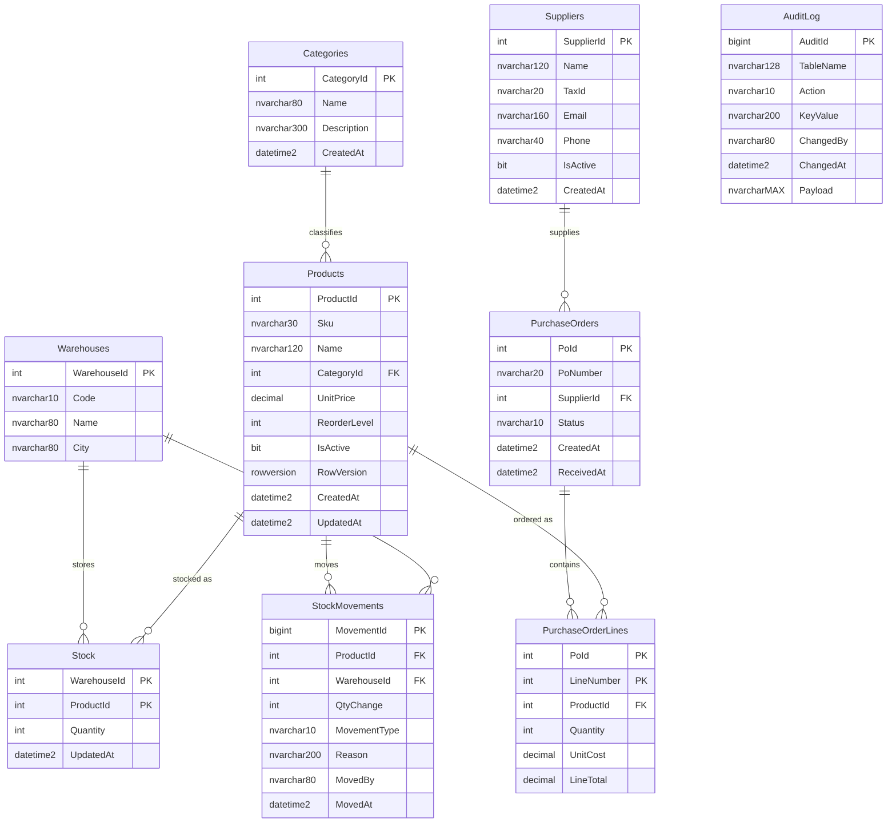

# Entity-Relationship Diagram

`PoNumber` has a default that pulls the next value from the sequence
`dbo.seq_PoNumber` (`N'PO-' + CAST(NEXT VALUE FOR dbo.seq_PoNumber AS NVARCHAR(10))`).
`AuditLog` is written by the trigger `dbo.trg_Products_Audit` on `Products`.
